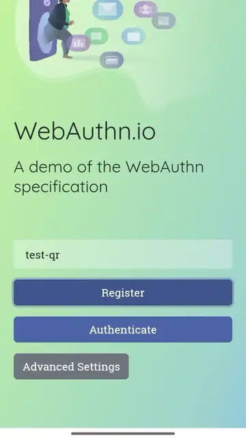

# LibreCaBLE

-3DDC84?logo=android&logoColor=white)

A lightweight, standalone FIDO2 hybrid transport (`caBLE v2` / CTAP 2.3 §11.5) and Proximity Exchange Protocol (PXP) passkey bridge for Android 14+ (API 34+). Built with zero Google Play Services dependencies, it works on **both standard Android devices and GMS-free custom ROMs** as either an **Authenticator** (scanning another device's QR code) or a **Client Platform** (displaying a QR code for another device to scan).

  

## Features

* **Authenticator Mode (Scan QR)**: Handles `FIDO:/` URIs via `VIEW` intents, advertises `0xFFF9` BLE proximity EIDs, and forwards CTAP2 requests to Android's `CredentialManager` with privileged `origin` and `clientDataHash` binding.
* **Client Platform Mode (Display QR)**: Implements `CredentialProviderService` to generate digit-encoded `FIDO:/` QR codes, scan `0xFFF9` BLE advertisements, verify browser origins against `privileged_apps.json`, and assemble WebAuthn responses (`COSE_Key` to SPKI, `credProps`, and `prf`).
* **Transport & Protocol**:
  * **Dual Transport**: Direct BLE L2CAP Connection-oriented Channels (CoC) over BLE 5.0 Extended Advertising, with automatic fallback to WebSocket relay tunnels (assigned domain `0` or hashed IDs `256–65535`).
  * **Cryptography & Codec**: `Noise_KNpsk0_P256_AESGCM_SHA256` handshakes, zero-dependency CTAP2 canonical CBOR codec (`MakeCredential`, `GetAssertion`, `GetInfo`, `Selection`), and WebAuthn `prf` extension support.

## Requirements & Usage

1. **System**: Android 14+ (API 34+) with Bluetooth enabled. Grant Nearby Devices (Bluetooth) permissions when prompted.
2. **Authenticator Mode (Scan a PC/Device QR Code)**:
   * Your local `CredentialManager` provider (e.g., Bitwarden) must allowlist LibreCaBLE to permit `CREDENTIAL_MANAGER_SET_ORIGIN`:
     * **Package Name**: `com.dev.fido.bridge`
     * **SHA-256 Fingerprint**: `86:44:E2:17:76:07:C7:5C:BC:B7:E3:DE:0E:AB:3E:BB:E6:3B:0B:59:56:BC:1C:A0:DB:EC:53:3E:49:31:1F:E1`
   * Use a QR scanner app that dispatches `VIEW` intents for `FIDO:/` URIs (such as [Binary Eye]).
   * *(Optional)* Configure a custom WebSocket tunnel domain ID (`0` or `256–65535`) via **⋮ > Extended Domain Settings**.
3. **Client Platform Mode (Sign in on This Device)**:
   * Enable **LibreCaBLE** in Android *Settings > Passwords & passkeys* (or via **⋮ > Enable Client Provider**).
   * Select **Scan QR code (LibreCaBLE)** in the system Passkey prompt and scan it with your authenticator device.
4. **Tunnel Domain Recommendation** (**⋮ > Extended Domain Settings**):
   * Try setting `0` (Google's official `cable.ua5v.com`) first.
   * If unreachable, keep the default (tap **Delete** to restore) or specify a custom ID (`256–65535`).

## Limitations (Not Implemented)

* **`attestation: "enterprise"`**: Enterprise attestation (`ep`).
* **`largeBlob`**: CTAP2 `largeBlobs` / `largeBlobKey` extension.

## License & Acknowledgments

Licensed under the [GNU General Public License v3.0 (GPLv3)](LICENSE).

* **[microG GmsCore](https://github.com/microg/GmsCore/)**: Protocol logic inspired by microG GmsCore ([Apache 2.0](https://github.com/microg/GmsCore/blob/master/LICENSE)).
* **[FIDO Alliance](https://fidoalliance.org/) & [W3C](https://www.w3.org/TR/webauthn-3/)**: CTAP 2.3, PXP, and WebAuthn specifications.
* **[Bitwarden](https://github.com/bitwarden/android)**: Open-source Android `CredentialManager` provider with privileged allowlist support.
* **[Authnkey](https://github.com/mimi89999/Authnkey)**: Referenced `privileged_apps.json` browser allowlist for Client Platform origin verification ([MIT License](https://github.com/mimi89999/Authnkey/blob/main/LICENSE)).
* **[Cloudflare](https://www.cloudflare.com/)**: WebSocket tunnel relay infrastructure.
* GitHub & LinuxDo

## Security & Build Provenance

* **Trusted Releases**: Starting from `v1.5.2`, official APKs are built via GitHub Actions and locked via GitHub Immutable Releases.
* **Disclaimer**: LibreCaBLE is an experimental Proof of Concept without formal security audits. It is **not affiliated with, endorsed by, or sponsored by** the FIDO Alliance, Google, Bitwarden, Authnkey, Cloudflare, or the microG Project.